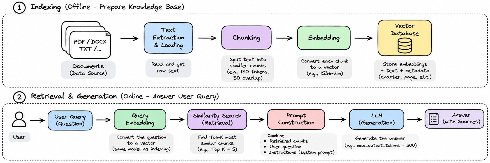

# PDF RAG Starter

Five files: the 3-page AI Engineering PDF, commented notebook, matching Python script, and diagram (plus this README).

```bash
pip install pymupdf tiktoken chromadb openai
export OPENAI_API_KEY="your-key"    # Windows PowerShell: $env:OPENAI_API_KEY="your-key"
jupyter notebook rag_tutorial.ipynb  # Or: python rag_tutorial.py
```

Run notebook cells top to bottom. Edit `QUESTION` to ask something else. Uses OpenAI API credits; the local ChromaDB folder is created on first run. Source `page` is the PDF page position. Scanned PDFs need OCR.
